# Block Editor Kit · 块式富文本编辑器

给网页和桌面应用接入 Notion 式编辑器，无需从零实现块拖拽、富文本、表格和撤销重做。组件使用原生 JavaScript 和 CSS，没有第三方运行依赖；也可通过配套的 [Agent Skill](#在智能体中安装-skill) 让 AI 辅助接入。

A lightweight Notion-style block editor for web and desktop WebViews, with an optional Agent Skill for assisted integration.

**[在线试用 / Live Demo](https://link0099.github.io/block-editor-kit/)** · **[接入项目 / Integration](block-editor-kit/references/integration.md)**



在线 Demo 为 0.2.3 预览版，无需安装或登录。也可[下载离线 HTML](docs/index.html)，在文件页点击下载后双击打开。仓库可集成源码版本：0.2.2。

## 本地运行源码示例

下载并解压仓库，在包含本 README 的目录运行以下命令。

```sh
python3 -m http.server 8000 --bind 127.0.0.1
```

浏览器打开 [编辑器演示](http://127.0.0.1:8000/block-editor-kit/assets/demo.html)。组件使用浏览器 ES Module，需要通过本地服务器打开。建议使用新版 Chrome 或 Edge。

## 在智能体中安装 Skill

[下载并解压 GitHub 源码 ZIP](https://github.com/link0099/block-editor-kit/archive/refs/heads/main.zip)。将内层含 `SKILL.md` 的整个 `block-editor-kit/` 目录复制到目标项目的对应位置，保留组件源码和参考文档。

| 产品 | 项目中的安装位置 | 官方文档 |
| --- | --- | --- |
| Codex | `.agents/skills/block-editor-kit/` | [安装位置](https://developers.openai.com/codex/skills) |
| Cursor | `.agents/skills/block-editor-kit/` | [安装位置](https://cursor.com/docs/skills) |
| GitHub Copilot | `.agents/skills/block-editor-kit/` | [安装位置](https://docs.github.com/en/copilot/how-tos/copilot-on-github/customize-copilot/customize-cloud-agent/add-skills) |
| Gemini CLI | `.agents/skills/block-editor-kit/` | [安装位置](https://geminicli.com/docs/cli/using-agent-skills/) |
| DeepSeek Harness | `.agents/skills/block-editor-kit/`（使用文件系统 Skill 加载器的配置） | [安装位置](https://github.com/deepseek-ai/deepseek-harness/tree/master/packages/skill/skill-filesystem) |
| Claude Code | `.claude/skills/block-editor-kit/` | [安装位置](https://code.claude.com/docs/en/skills) |

从目标项目启动智能体后，输入「使用 block-editor-kit Skill，给这个页面接入块式富文本编辑器」。也可以通过产品自己的 Skill 菜单或命令选中它。安装位置适用于相应产品配置中已启用 Skill 的环境。

### 通过网页上传

如果用 Claude 网页版，将解压得到的内层 `block-editor-kit/` 文件夹单独压成 ZIP。ZIP 内第一层应是 `block-editor-kit/`，打开这一层即可看到 `SKILL.md`。在 Claude 的 **Customize → Skills** 上传并启用。使用 ChatGPT 且账号有 Skills 上传入口时，可从 **Plugins → Skills → Create → Upload from your computer** 选择本地 Skill 包。[Claude 上传说明](https://support.claude.com/en/articles/12512198-how-to-create-custom-skills) · [ChatGPT 上传说明](https://help.openai.com/en/articles/20001066-skills-in-chatgpt)

## 在应用中直接使用组件

把 [assets](block-editor-kit/assets/) 中的 JavaScript 模块和 `editor.css` 放进项目，使用 `mountBlockEditor(host, options)` 挂载，接入应用已有的主题与保存流程。详见[接入指南](block-editor-kit/references/integration.md)。

## 开发验收

运行 `node --test tests/history.test.mjs` 检查 100 步边界和历史分支。启动本地服务器后，打开 [历史回归页](http://127.0.0.1:8000/tests/editor-history.html)，检查快捷键、按钮、编辑事务和切换文档；打开 [布局回归页](http://127.0.0.1:8000/tests/editor-viewport.html)，检查安全区及窄窗折行。预期均显示 `PASS`。

## License

[MIT](LICENSE)
